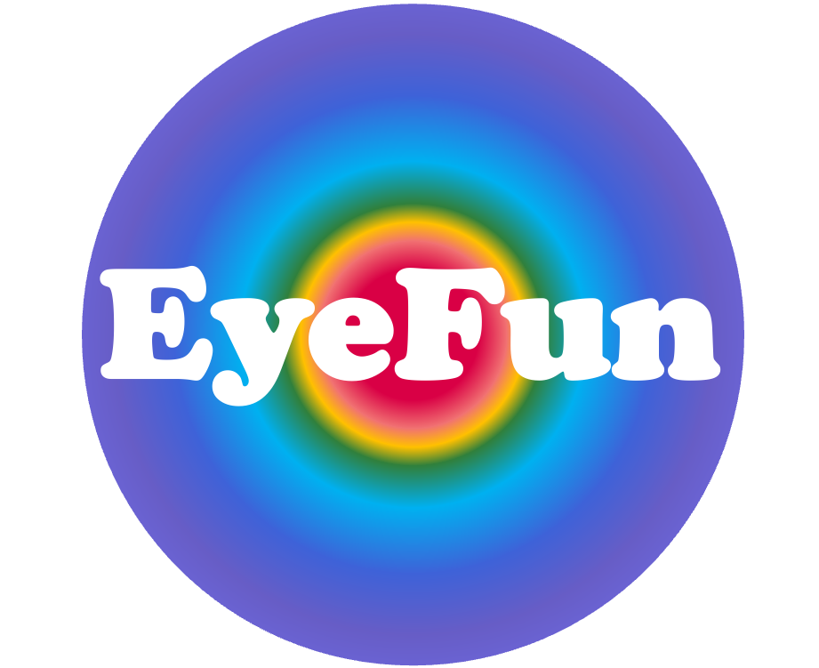

[](https://igmmgi.github.io/EyeFun.jl/dev/)
[](https://github.com/igmmgi/EyeFun.jl/actions/workflows/ci.yml)
[](https://opensource.org/licenses/MIT)


# EyeFun.jl




A Julia package for eye-tracking analysis and visualization.

## Features

- **File I/O**: Pure-Julia readers for **EyeLink** (`.edf`, `.asc`), **SMI** (`.idf`, `.txt`), **Tobii** (`.tsv`), delimited **CSV/TSV**, and **BIDS** (`*_eyetrack.tsv` + `.json`), plus EyeLink ASCII export (`write_et_ascii`) and calibration inspection (`calibration_summary`).
- **Tabular Data**: `read_et_data` and `create_eyefun_data` align continuous gaze/pupil samples, event annotations, trial markers, and trial variables into an `EyeData` container backed by a `DataFrame`.
- **Preprocessing & Coordinates**: Filtering, gap/blink interpolation, pupillometry preprocessing, foreshortening correction, drift correction, and pixel/visual-angle coordinate conversion (`velocity_filter!`, `savitzky_golay_filter!`, `pupil_filter!`, `correct_pupil_foreshortening!`, `interpolate_gaps!`, `interpolate_blinks!`, `smooth_pupil!`, `drift_correct!`, `set_time_zero!`, `px_to_deg`, `deg_to_px`, `to_center_coords!`).
- **Event Detection & Scanpaths**: Adaptive I-VT / I-DT detection with saccade onset/offset refinement and post-saccadic oscillation tagging (`detect_events!`), monocular and binocular microsaccade detection (`detect_microsaccades!`, `microsaccades`), and Levenshtein or 5D MultiMatch scanpath comparison (`scanpath_similarity`, `transition_matrix`).
- **AOIs, Metrics & Statistics**: Static and dynamic regions (`RectAOI`, `CircleAOI`, `EllipseAOI`, `PolygonAOI`, `DynamicAOI`), `aoi_metrics`, `proportion_of_looks`, `data_quality`, `spatial_precision`, `fixation_metrics`, `saccade_metrics`, `pupil_peak_metrics`, `empirical_logit`, `growth_curve_data`, and `cluster_permutation_test`.
- **Plotting**: Interactive and static figures via Makie (`plot_databrowser`, `plot_gaze`, `plot_scanpath`, `plot_heatmap`, `plot_fixations`, `plot_pupil`, `plot_velocity`, `plot_dwell`, `plot_sequence`, `plot_transitions`, `plot_time_course`).

## Installation

```julia
using Pkg
Pkg.add(url="https://github.com/igmmgi/EyeFun.jl")
```

## Quick Start

```julia
using EyeFun

# Read data from your eye tracker
dat = read_et_data("path/to/your/eye_tracking_file/file.edf") # EyeLink (.edf or .asc)

# Interactive databrowser
plot_databrowser(dat)                   # whole dataset
plot_databrowser(dat; split_by=:trial)  # split by trial
```

<video controls autoplay loop muted src="https://github.com/user-attachments/assets/89daec56-2699-47ff-96a2-3110d4acdda5"></video>

> **Work In Progress**: This is an active exploratory alpha stage codebase. APIs are subject to change without notice. Use at your own risk.

## Acknowledgements

The `.edf` binary file reader was reverse-engineered with significant assistance from Anthropic's Claude (https://claude.com/).
